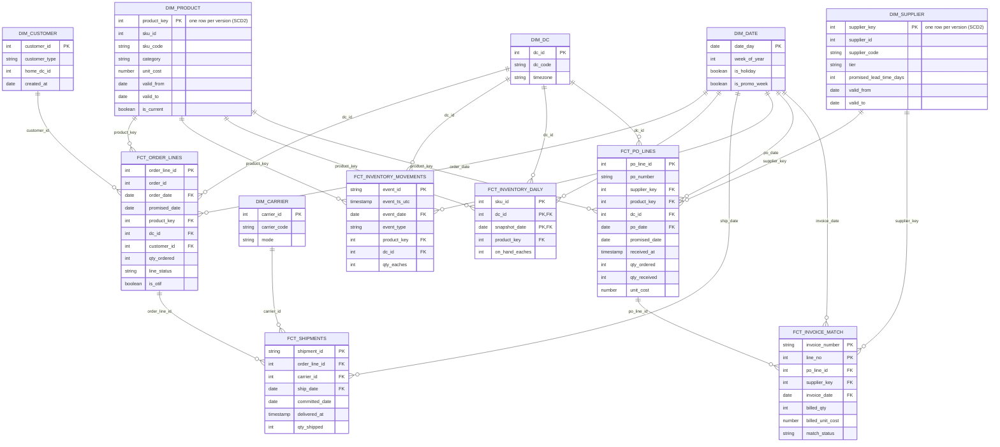

# Data model

## Bus matrix

Which dimensions each fact joins to directly.

|Fact|date|product|supplier|dc|customer|carrier|
|-|-|-|-|-|-|-|
|fct_order_lines|Yes|Yes||Yes|Yes||
|fct_shipments|Yes|||||Yes|
|fct_inventory_movements|Yes|Yes||Yes|||
|fct_inventory_daily|Yes|Yes||Yes|||
|fct_po_lines|Yes|Yes|Yes|Yes|||
|fct_invoice_match|Yes||Yes||||

## Entity relationship diagram

Facts point at dimensions. SCD2 dimensions (product, supplier) have one row per version, and facts store the key of the version that was valid on the fact's date.

